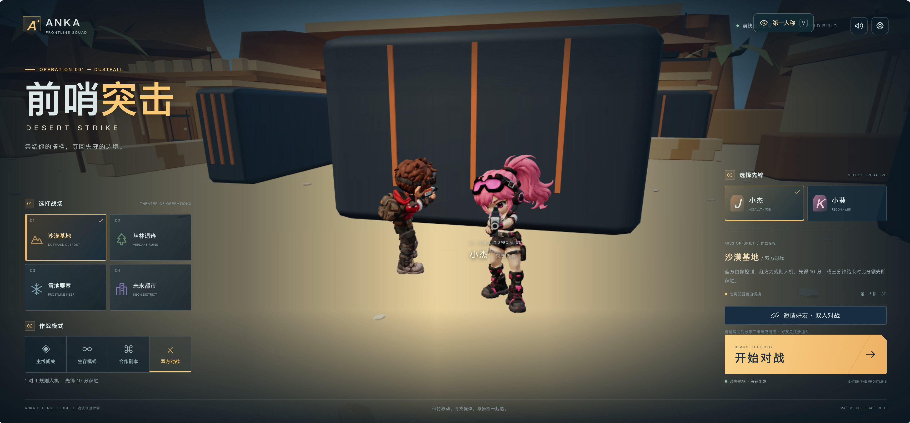

# ANKA · 前哨突击（Vue + Three.js）



**1.1 更新**：默认第一人称，按 V 或视角按钮切换；加入双方同步的五类地面补给，靠近 / F / 点击拾取；对战地图扩大并增加遮挡，复活优先远离敌人。详见 [本次玩法说明](docs/GAMEPLAY-1.1.md)。

游戏首页为 `index.html`，角色动作实验室为 `characters.html`。已接入你提供的两份 Mixamo FBX，男女角色各有 16 段动画；游戏使用新版 `assets/characters/mixamo/*_aim.glb`。原始 Tripo 资产保留。完整16动作的可编辑源文件为 `source/male_scout_game.blend` 与 `source/female_striker_game.blend`。

当前是可玩的第一版：四种战场（沙漠、丛林、雪地、都市）、主线三波及三阶段 Boss、生存无限波、AI 合作与 Anka 鉴权双人房间、三分钟 PvP、七种武器、补给、手雷、护盾、救援、小地图、音效、暂停与结算。沙漠基地为首个主场景；环境与机器人为程序构建的低多边形风格，尚未达到概念图的美术精度。真人房间固定两人，通过 Anka WebSocket 转发，扫码免注册加入；邀请 10 分钟有效，兑换后的访客身份独立有效 24 小时。房主统一计算战斗，适用于好友对战。

Anka 安装、邀请、部署与验证见 [接入文档](docs/ANKA-INTEGRATION.md)。

单人开发启动：`npm install` 后运行 `npm run dev`，打开终端打印的本地地址。`npm run build` 生成 `dist/`。

操作：WASD / 方向键移动，V 切换第一 / 第三人称，第一人称点击画面锁定鼠标转向，左键或 J 射击，右键拖动转视角 / 缩放瞄准，1–7 / 滚轮换枪，R 换弹，Space 跳跃，Shift 翻滚，C 按住蹲伏，Alt 冲刺，G 手雷，E 医疗包，Q 护盾，F 拾取 / 救援，Esc 释放鼠标并暂停单人战斗。触屏提供摇杆、拖动视角、持续开火与动作按钮。补给靠近自动拾取，也可点击提示拾取。

检查：`npm run test:game` 检查四地图完整波次和武器/生命逻辑；`npm run validate:aim` 检查两模型的 16 段动画、骨骼与 glTF。检查记录与真实浏览器截图位于 `reports/game/`，动作来源和重定向脚本见 `reports/mixamo/README.md`。自动通关测试是控制器测试，不等同于真人完整通关。

在线私有发布的上传步骤被自动审批拦截，尚未上传或上线。`sites/anka-frontline/.openai/hosting.json` 保留已创建但未发布的 Site 身份，避免后续重复创建。

以下为原始角色制作与 Tripo 资产记录。

两名角色来自已确认的男女三视图，通过 Tripo 国内环境生成模型、贴图、骨骼和动画，随后在本地 Blender 整理为 Three.js 可直接加载的 GLB。

## 双方对战 · 行为树战术人机

现在默认选中“双方对战”，点击“开始对战”即可进行蓝方玩家 VS 红方人机的 1 对 1。选择男角色时人机为女角色，反之亦然；使用现有带贴图角色和持枪动画。

规则：先得 **10 分**获胜，每次击倒得1分；比赛最长 **180秒**，到时按比分判定胜/负/平局。双方倒地3秒后复活，复活保护2秒；玩家开火会提前结束自己的保护。复活时补满弹匣与弹药、恢复医疗包/手雷/护盾，保留本场比分。死亡期间不能用医疗包或手雷绕过复活规则。HUD显示双方比分、剩余时间、对手血条/状态和复活倒计时；小地图标出红方。

人机现在使用轻量行为树，包含响应式优先 Selector 和跨帧记忆 Sequence。支持“进入掩体 → 隐蔽 → 探头射击 → 退回”和“短时压制 → 绕到侧翼 → 换角度开火”。受伤与换弹能抢占低优先级战术，移动超时和战术冷却防止卡墙或重复切换。感知基于视野、遮挡、枪声线索和位置记忆，保留反应延迟与射击误差；A* 负责实际绕障。复活点仍作为公开比赛信息告知人机。结构与限制见 `reports/game/behavior-tree.md`。

检查：`npm run test:ai`（行为树与战术），`npm run test:duel`（命中/爆炸、双方计分、复活/保护、重复寻敌、墙体、10分胜负、时间到平局、暂停、重开清理、四地图导航）；`npm run test:duel:ui` 检查比分与胜负平局界面。结果在 `reports/game/duel-checks.json`，实现为 `game/duel.js` 和 `game/navigation.js`。

## 已完成资产

| 角色 | 游戏 GLB | 三角面 | 骨骼 | 材质 | 贴图 | 文件大小 |
|---|---|---:|---:|---:|---|---:|
| 小杰 / Scout | `assets/characters/tripo/male_scout_animated.glb` | 19,800 | 65 | 1 | 三张 2K PBR 贴图，内嵌 | 7.1 MiB |
| 小葵 / Striker | `assets/characters/tripo/female_striker_animated.glb` | 19,800 | 65 | 1 | 三张 2K PBR 贴图，内嵌 | 7.3 MiB |

每个 GLB 都有五段可独立切换的骨骼动画：`Idle`、`Walk`、`Run`、`Jump`、`Shoot`。使用 Mixamo 兼容骨架。GLB 的 Y 轴向上，正面朝 +Z，单位为米；绑定姿态身高统一为 2 米，脚底作为原点基准。动画为原地动作，由游戏代码控制角色的世界位移、转向和跳跃高度。

## 本地预览

```bash
npm install
npm run dev
```

游戏首页：`http://127.0.0.1:5173/`。角色实验室：`http://127.0.0.1:5173/characters.html`，支持双人/单人、16 段动作、暂停、正背视角、旋转与线框。

Three.js 加载与动作切换封装在 `demo/characters.js`：

```js
import { loadCharacter } from './demo/characters.js';

const scout = await loadCharacter('male');
scene.add(scout.model);
scout.play('Run');

// 在游戏主循环中调用：
scout.update(deltaSeconds);
// 角色位移与物理逻辑由游戏控制：
scout.model.position.z += speed * deltaSeconds;

// 不再使用时：
scout.dispose();
```

加载相同角色的多个实例时，分别调用加载函数或用 Three.js 的 `SkeletonUtils.clone`，确保每个实例有独立骨架和 AnimationMixer。

## 可编辑文件与来源

- `source/anka_tripo_characters.blend`：双人演示场景，打开即为待机姿态，含各角色五段动作和高清贴图。
- `source/anka_tripo_male_scout.blend`、`source/anka_tripo_female_striker.blend`：各自独立、可编辑的角色源文件，保留原始高清贴图。
- `assets/characters/tripo/raw/`：原始静态生成模型和预览。
- `assets/characters/tripo/tripo-out/`：Tripo 原始骨骼、五段动画 GLB 和每个任务的 `task.json`。
- `references/tripo/`：实际上传的六张参考图。根据画面朝向，男角色标为右侧视图，女角色标为左侧视图。
- `output/character-turnarounds/`：原先生成的三视图总览及单视角 PNG。
- `renders/tripo/`：实际 Blender 模型的待机、跑步、背面渲染，以及 Three.js 预览截图。

Blender 中选择相应角色的骨骼，切换 Action 或对应的 NLA 轨道即可播放五段动作。所有 NLA 轨道默认静音，避免多个动作同时叠加；当前 Action 为 Idle。

## 生成与本地处理

建模：`tripo-v3.1` / `v3.1-20260211`，三视图输入，PBR 高清贴图和 Smart Low-poly。绑定：`rig-v3.0` / `v3.0-20260909`，`spec=mixamo`。动画：五段 Tripo 预设，`animate_in_place=true`，GLB 输出。

Tripo 原始网格分别为 27,654 和 25,273 三角面；本地优化到各 19,800，并保留 UV 与骨骼权重。每顶点最多四个骨骼影响。游戏版贴图整理为 2K，原始高清贴图保留在源文件中。材质保留生成的底色、法线和金属度贴图，粗糙度统一为 0.58。归一化导出切线，修复少数退化 UV 顶点的零切线。

重新制作本地交付文件可使用 `scripts/finalize_tripo_character.py`；导出后运行 `python3 scripts/repair_glb_tangents.py`。这些操作不调用 Tripo，不消耗积分。双人场景和实际渲染由 `scripts/build_tripo_review_scene.py` 构建。

## 验证

```bash
npm run validate
npm run validate:motion
npm run build
```

- Khronos glTF Validator：两份模型均 0 错误，均验证内嵌贴图、骨骼和五个非空动作。
- Three.js 数据检查：每段动作六个时间点，对全部蒙皮顶点求实际变形范围，检查异常值与失控变形；两角色的 Idle → Run 过渡通过。
- 浏览器：模型加载成功，五段动作切换已逐项操作确认。
- 验证器保留一个 `NODE_SKINNED_MESH_NON_ROOT` 警告，来自统一比例/朝向的外层节点。骨骼与网格处于同一外层节点，Three.js 的变形与切换检查已通过。

报告见 `reports/tripo/gltf-validation.json`、`reports/tripo/threejs-motion-check.json`，文件尺寸及 SHA-256 见 `assets/characters/tripo/manifest.json`。

## 实际费用

男角色：建模 50 + 免费检查 0 + 绑骨 25 + 五动画 50 = **125 积分**。

女角色：建模 50 + 免费检查 0 + 绑骨 25 + 五动画 50 = **125 积分**。

总计 **250 积分**，余额从 600 变为 **350 积分**，冻结积分为 0。每项任务的完整 Task ID 和实际扣费记录在 `reports/tripo/cost-report.md`。所有生成均在国内环境 `cn` 完成，没有读取或写入项目 API Key。
