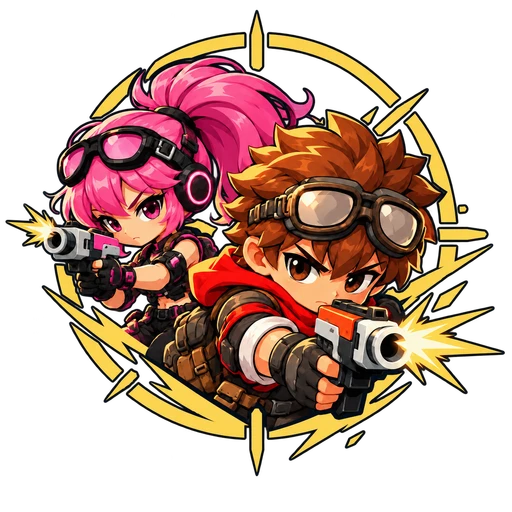
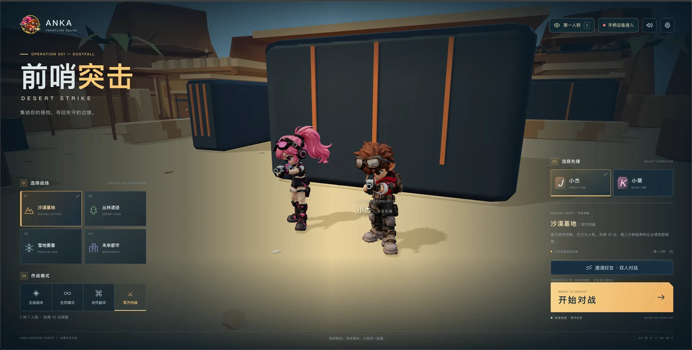

# ANKA · 前哨突击

**简体中文** | [English](README.en.md)



基于 **Vue 3、Three.js 和 Vite** 开发的 Q 版 3D 射击游戏，支持第一 / 第三人称、桌面键鼠和手机 / iPad 触控。可独立体验单人玩法，也可作为 Anka 插件进行好友对战。



## 已实现功能

| 模块 | 功能简述 |
| --- | --- |
| 双角色与视角 | 小杰、小葵可选；第一 / 第三人称切换；持枪、瞄准、移动、跳跃等角色动画。 |
| 地图与模式 | 沙漠基地、丛林遗迹、雪地要塞、未来都市；主线三波战斗与 Boss、生存模式、AI 搭档合作、人机对战。 |
| 武器与战斗 | 七类武器、换弹、后坐力、枪口火光、曳光与命中效果；手雷、医疗包、护盾、地面补给和搭档救援。 |
| 战术人机 | 行为树决策、掩体、探头射击、压制与侧翼移动，结合视野 / 遮挡感知和 A* 寻路。 |
| 好友对战 | Anka 鉴权双人房间、二维码 / 链接邀请、免注册访客加入、准备与同步开局、计分、复活和结算。 |
| 手机与 iPad | 横屏布局、竖屏旋转适配、多指移动 / 开火 / 转向；全屏空白区域可拖动视角，紧凑血量与比分，右上角视角切换。 |
| 界面与设备 | 小地图、暂停、画质和音频设置；桌面支持手柄设备接入，手机与 iPad 不显示该入口；游戏内使用透明双人 LOGO。 |
| 资源与交付 | 两角色各保留 65 根骨骼、16 段动画；运行模型使用 Meshopt / WebP 优化，构建自动生成 Brotli / Gzip 资源。 |

**对战规则：** 1 对 1，先得 10 分或在 180 秒结束时领先者获胜，同分为平局；倒地 3 秒后复活，保护期 2 秒，开火提前结束保护。默认可直接开始人机对战；真人联机当前为双人 PvP，合作模式使用 AI 搭档。

## 快速开始

### 环境要求

- **Node.js 22.12+** 与 npm。
- **Git LFS**：模型、FBX 和 Blender 源文件通过 LFS 管理。
- 支持 WebGL 2 的浏览器；联机与设备接入另外依赖 Anka 宿主服务。

在项目根目录运行：

```bash
git lfs install
git lfs pull
npm ci
npm run dev
```

- 游戏：<http://127.0.0.1:5173/>
- 角色动作实验室：<http://127.0.0.1:5173/characters.html>

以终端输出的实际地址为准。角色实验室可单独预览双角色、16 段动作、正背视角和线框。

### 构建

```bash
npm run build
```

产物位于 `dist/`，包含 `build.json` 及预压缩资源。构建先在暂存目录完成，成功后再替换现有产物。`dist/` 与 `node_modules/` 不纳入版本控制。

独立开发服务支持单人玩法；邀请好友、房间同步及手柄接入需要从 Anka 打开。安装、HTTPS / WSS 和部署配置见 [Anka 接入文档](docs/ANKA-INTEGRATION.md)。

## 操作说明

### 桌面

| 操作 | 按键 / 输入 |
| --- | --- |
| 移动 / 冲刺 | `WASD` 或方向键 / 左 `Alt` |
| 射击 / 瞄准 | 鼠标左键或 `J` / 鼠标右键 |
| 转动视角 | 第一人称点击画面锁定鼠标后移动；也可按住右键拖动 |
| 切换视角 / 武器 | `V` / `1–7` 或滚轮 |
| 换弹 / 跳跃 / 翻滚 | `R` / `Space` / `Shift` |
| 蹲伏 | 按住 `C` |
| 手雷 / 医疗包 / 护盾 | `G` / `E` / `Q` |
| 拾取 / 救援 | `F`；补给也可靠近自动拾取或点击提示 |
| 暂停 / 继续 | `Esc`；暂停时释放鼠标锁定 |

### 手机与 iPad

左下摇杆移动，所有空白区域均可拖动转向；右侧提供开火、瞄准与动作按钮。按住开火连续射击，拖动开火键可同时转向；支持多指操作，点击换枪展开武器列表。视角切换位于右上角，暂停时隐藏。

开始游戏时尝试全屏与横屏锁定；浏览器不支持方向锁定时使用旋转布局。暂停、触控取消或屏幕方向变化会释放持续输入。手机与 iPad 不加载手柄接入组件；桌面设备接入使用 Anka 的设备服务。

## 开发与验证

| 命令 | 用途 |
| --- | --- |
| `npm run dev` | 启动本地开发服务 |
| `npm run build` | 构建游戏和角色实验室 |
| `npm run test:game` | 地图波次、武器、生命值与基础战斗逻辑 |
| `npm run test:duel` / `npm run test:ai` | 对战计分、复活、战术人机与导航 |
| `npm run test:online` | 联机战斗与同步逻辑 |
| `npm run test:fps` / `npm run test:shots` | 第一人称补给、枪口与弹道效果 |
| `npm run test:controller` | 设备输入路由、释放与控制权切换 |
| `npm run test:models` / `npm run validate:aim` | 优化模型、动画与骨骼验证 |
| `npm run test:mobile` | 浏览器触摸、多指操作、全屏转向区域与旋转适配 |

移动端浏览器验证需先运行 `npm run dev`，并准备 Playwright 使用的 Chromium：

```bash
npx playwright install chromium
npm run test:mobile
```

可通过 `ANKA_QA_URL` 指定开发地址，或通过 `PLAYWRIGHT_CHROMIUM_EXECUTABLE` 指定已有的 Chromium。真人房间端到端验证见 [Anka 接入文档](docs/ANKA-INTEGRATION.md)，模型视觉与传输验证见 [资源优化文档](docs/ASSET-OPTIMIZATION.md)。报告通常输出到 `reports/`；浏览器设备模拟不等同于 iOS / Android 真机验收。

## 项目结构

```text
├── game/                   # Vue 界面、游戏循环、角色、战斗与输入
│   ├── engine.js           # 场景和玩法调度
│   ├── duel-brain.js       # 战术人机；行为树与导航见同目录模块
│   ├── network.js          # Anka 房间与 WebSocket 传输
│   └── mobile.css          # 手机 / iPad 布局
├── assets/
│   ├── characters/         # 运行模型及 Tripo / Mixamo 资产
│   └── branding/           # 透明 LOGO、蓝黑底应用图标与设计方案
├── demo/                   # 角色动作实验室
├── server/                 # Anka 插件后端定义
├── web/                    # Anka 宿主入口
├── source/                 # 可编辑 Blender 源文件与模型备份
├── scripts/                # 构建、资源处理与验证工具
├── docs/                   # 接入、玩法与优化说明
└── reports/                # 模型、动画、测试与制作记录
```

## 资源与技术文档

- [Anka 安装、邀请与部署](docs/ANKA-INTEGRATION.md)
- [模型与传输优化](docs/ASSET-OPTIMIZATION.md)
- [行为树结构与限制](reports/game/behavior-tree.md)
- [Mixamo 动作重定向](reports/mixamo/README.md)
- [Tripo 制作费用与任务记录](reports/tripo/cost-report.md)
- [LOGO 与应用图标资源](assets/branding/README.md)：游戏内使用透明版，蓝黑底原图保留用于后续 ANKA 应用图标。
- 历史玩法说明：[1.1](docs/GAMEPLAY-1.1.md) · [1.2](docs/GAMEPLAY-1.2.md)

游戏与角色实验室均加载 `assets/characters/optimized/`。原始 Tripo / Mixamo 模型与 Blender 文件独立保留，旧版五段动画资产不代表当前运行模型的完整动作集。环境与机器人采用程序化低多边形风格；当前版本面向单人体验和好友对战，联机战斗由房主裁定。
