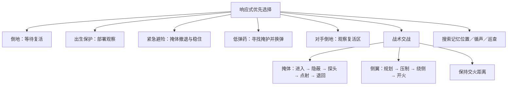

# 1 对 1 行为树人机

当前仍为一名玩家对抗一名人机，10分/180秒/3秒复活的比赛规则保留。无需新增模型、服务或生成积分。

## 运行结构

- `game/behavior-tree.js`：Action、Condition、Sequence、Selector、BehaviorTree，统一返回 success / failure / running。
- 根 Selector 每帧重新评估优先级，可以打断低优先级动作；Action 的 enter/tick/exit 与 aborted 清理保证不会继续执行旧移动/射击意图。
- 战术内部用记忆型 Sequence，跨帧保留正在执行的阶段，完成前不会每帧重选战术。
- `game/duel-brain.js` 产生移动目标、瞄准、射击、蹲伏和状态意图；`game/duel.js` 负责比赛、A*执行、实际射击射线、动画和复活。

## 玩家能感受到的变化

掩体战术使用实际遮挡位置与可达的露头点；隐蔽时停止射击，探头后有反应和瞄准时间。绕侧先短暂压制，再换位置开火。战术带冷却和移动超时，避免一直贴同一处墙或反复切换计划。受伤和缺弹可以中断战术，给玩家追击机会。

感知使用150度水平视野、近身感知、墙体遮挡与最后位置记忆。30米内枪声提供带约1.5米误差的位置线索；看不到玩家时不会持续读取其坐标来追踪，记忆过期后进行区域巡查。复活点仍是公开比赛事件，双方复活后会清除旧战术并更新复活区域信息。

AI仍遵守现有的反应时间、弹匣、换弹、误差、实际命中射线和伤害规则。蹲伏时使用较低的命中区域，掩体会挡子弹。没有新增人机队友、多人战术协同或机器学习训练。

## 验证

`npm run test:ai` 检查优先级抢占、Action中止清理、记忆序列、返回值契约，以及真实控制器中的掩体探头、压制绕侧、受伤/换弹抢占、视野/声音记忆和移动超时。记录见 behavior-tree-checks.json。`npm run test:duel` 回归四地图路径、计分、复活、胜负和平局；`npm run test:game` 回归原关卡；`npm run test:duel:ui` 检查结果界面；`npm run build` 构建产物。
